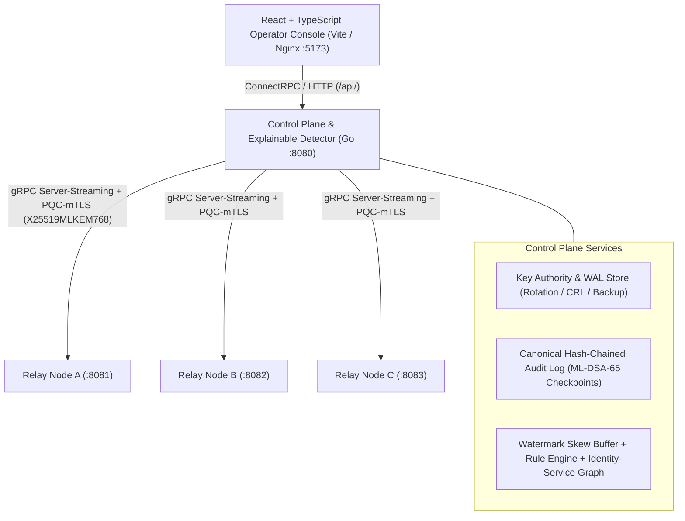

# urGuard

**Post-Quantum Zero-Trust Messaging, Key Lifecycle & Explainable Access Guard**

urGuard combines hybrid post-quantum end-to-end encryption (`X25519 + ML-KEM-768`, `AES-256-GCM`, `ML-DSA-65`) and crash-safe multi-node key governance with a deterministic, zero-AI/ML explainable lateral-movement and activity detection engine.

---

## Architecture



---

## Prerequisites

| Tool | Required Version | Verified Version | Notes |
|---|---|---|---|
| Git | `2.40+` | `2.50.1` | Required for cloning and LF line-ending handling |
| Docker Engine | `24.0+` | `[TODO: verify local version]` | Linux container engine for multi-node stack |
| Docker Compose | `v2.24+` | `[TODO: verify local version]` | Supports `env_file.required: false` |
| Go | `1.24.2+` | `[TODO: verify local version]` | Required for `crypto/mlkem` and `X25519MLKEM768` |
| Node.js | `22.13+` (`22.x` / `26.x`) | `26.13.1` | Required by Vite 8, Vitest 5, ESLint 10 |
| npm | `10.0+` | `11.1.0` | Package installation and `frontend` scripts |
| GNU Make | `4.0+` | `4.4.1` | Runs unified workflow targets |
| OpenSSL | `3.x` | — | Used by `deployments/gen-certs.sh` (or Alpine container) |

### Windows Notes
- Run `make` and all `.sh` scripts inside **Git Bash** (not `cmd.exe` or Windows PowerShell, where `C:\Windows\System32\bash.exe` can shadow Git Bash).
- LF line endings are enforced via `.gitattributes` and `.editorconfig`.
- Ensure **Docker Desktop** is open with the Linux engine running before executing `make up` or `docker compose`.
- Scripts export `MSYS_NO_PATHCONV=1` automatically so OpenSSL `-subj "/O=.../CN=..."` flags are not rewritten by Git Bash.

---

## One-Command Quickstart

```bash
cp .env.example .env && make up
```

- **Full multi-node stack** (requires `backend/` merged by Engineers A & B): starts `certs-init` → `controlplane` (`:8080`) → `node-a/b/c` (`:8081–:8083`) → `frontend` (`:5173`).
- **Standalone Operator Console (Mock Mode, works before `backend/` lands):**
  ```bash
  cd frontend && npm ci && npm run dev
  ```
  Open **http://localhost:5173** (uses `VITE_USE_MOCKS=true` by default).

---

## Makefile Targets

| Target | Command / Behavior |
|---|---|
| `make` / `make help` | Default target; lists all Make targets |
| `make codegen` | Generates ConnectRPC/Protobuf TypeScript (`frontend/src/gen/`) and Go bindings from `backend/proto/` |
| `make build` | Builds production frontend (`frontend/dist/`) and Go binaries (`bin/`) when `backend/go.mod` exists |
| `make test` | Runs `tsc --noEmit`, `eslint .`, `vitest run`, and `go test -race ./...` when `backend/go.mod` exists |
| `make verify` | Runs `scripts/clean-machine-check.sh` and `scripts/verify.sh` |
| `make bench` | Runs `scripts/bench.sh` for PQC latency, throughput, and detection evaluation metrics |
| `make up` | Starts `certs-init`, `controlplane`, `node-a/b/c`, and `frontend` via `deployments/docker-compose.yml` |
| `make down` | Stops and removes the Compose stack |
| `make clean` | Removes `frontend/dist`, `frontend/coverage`, `bin`, and `coverage` |

---

## Grace Period & Clock-Skew Bounds

| Parameter | Env Variable | Default | Tested / Enforced Bound |
|---|---|---|---|
| Key Rotation Grace Period | `URGUARD_ROTATION_GRACE_SEC` | `30` seconds | `IDLE → PREPARING → COMMITTED → CUTOFF_ENFORCED`; after cutoff, older epochs fail with `ERR_KEY_EPOCH_EXPIRED` |
| Detector Clock-Skew Watermark | `URGUARD_MAX_CLOCK_SKEW_SEC` | `30` seconds (`±30s`) | Tested up to `±60s`; pairs separated by `< 2 * skew` are flagged `order_uncertain: true`; late events flagged `late_arrival: true` |
| CRL Heartbeat Reconciliation | `URGUARD_CRL_HEARTBEAT_SEC` | `1` second | Backstop alongside gRPC server-streaming CRL push |

---

## Dependency Inventory (Zero AI/ML Policy)

Automated enforcement: `bash scripts/check-no-ai-deps.sh` (runs in CI on every push and PR).

### Frontend Packages (`frontend/package.json`)

**Runtime Dependencies:**

| Package | Version | Purpose | License |
|---|---|---|---|
| `@bufbuild/protobuf` | `2.17.0` | Protobuf-ES v2 runtime and message helpers | `Apache-2.0 AND BSD-3-Clause` |
| `@connectrpc/connect` | `2.3.0` | Type-safe ConnectRPC client core | `Apache-2.0` |
| `@connectrpc/connect-web` | `2.3.0` | Browser Fetch transport for Connect / gRPC-Web | `Apache-2.0` |
| `@xyflow/react` | `13.0.2` | Interactive identity-to-service access graph | `MIT` |
| `react` | `19.3.1` | UI component runtime | `MIT` |
| `react-dom` | `19.3.1` | DOM renderer | `MIT` |
| `react-router` | `8.5.3` | Console client-side routing | `MIT` |

**Development Dependencies:**

| Package | Version | Purpose | License |
|---|---|---|---|
| `@bufbuild/buf` | `1.75.0` | Protobuf lint and codegen CLI | `Apache-2.0` |
| `@bufbuild/protoc-gen-es` | `2.17.0` | Unified Protobuf-ES / Connect v2 code generator | `Apache-2.0` |
| `@eslint/js` | `10.0.1` | Core ESLint JavaScript ruleset | `MIT` |
| `@testing-library/jest-dom` | `8.0.0` | DOM assertion matchers for Vitest | `MIT` |
| `@testing-library/react` | `16.3.3` | React component testing helpers | `MIT` |
| `@types/react` | `19.3.1` | TypeScript declarations for React | `MIT` |
| `@types/react-dom` | `19.3.0` | TypeScript declarations for React DOM | `MIT` |
| `@vitejs/plugin-react` | `6.3.0` | React Fast Refresh and JSX Vite plugin | `MIT` |
| `eslint` | `10.15.0` | Static code linter | `MIT` |
| `eslint-config-prettier` | `10.1.8` | Disables ESLint formatting rules conflicting with Prettier | `MIT` |
| `eslint-plugin-react-hooks` | `7.1.1` | React Hooks correctness checks | `MIT` |
| `eslint-plugin-react-refresh` | `0.5.7` | Fast Refresh export validation | `MIT` |
| `globals` | `17.14.0` | Standard browser global identifiers | `MIT` |
| `jsdom` | `31.0.1` | Headless DOM environment for Vitest | `MIT` |
| `prettier` | `3.10.1` | Code formatter | `MIT` |
| `typescript` | `5.9.3` | Strict static type checker | `Apache-2.0` |
| `typescript-eslint` | `8.74.0` | Type-aware ESLint parser and rules | `MIT` |
| `vite` | `8.3.8` | Frontend bundler and dev server | `MIT` |
| `vitest` | `5.1.2` | Unit and component test runner | `MIT` |

### Go Modules (`backend/go.mod`)

> **Note:** `backend/go.mod` is owned by Engineers A & B and is not yet merged on this branch. Populate exact pinned versions from `backend/go.mod` once merged:

| Module | Version | Purpose | License |
|---|---|---|---|
| Go stdlib (`crypto/mlkem`, `crypto/tls`, `crypto/aes`, `crypto/cipher`) | `go1.24.2+` | Hybrid `X25519MLKEM768` TLS, `ML-KEM-768`, `AES-256-GCM` | `BSD-3-Clause` |
| `github.com/cloudflare/circl` | `[TODO: from backend/go.mod]` | Standardized `ML-DSA-65` signatures & PQC primitives | `[TODO: verify go.mod]` |
| `connectrpc.com/connect` | `[TODO: from backend/go.mod]` | ConnectRPC / gRPC-Web / HTTP handlers | `[TODO: verify go.mod]` |
| `google.golang.org/grpc` | `[TODO: from backend/go.mod]` | Inter-node gRPC server-streaming | `[TODO: verify go.mod]` |
| `google.golang.org/protobuf` | `[TODO: from backend/go.mod]` | Protobuf runtime | `[TODO: verify go.mod]` |
| `golang.org/x/crypto` | `[TODO: from backend/go.mod]` | `HKDF-SHA256` & `Argon2id` KDF | `[TODO: verify go.mod]` |
| `go.etcd.io/bbolt` / `modernc.org/sqlite` | `[TODO: from backend/go.mod]` | Crash-safe WAL key & audit persistence | `[TODO: verify go.mod]` |

---

## Track 4 Checklist Verifications (12 Objectives)

Run automated clean-machine & end-to-end checks via `make verify` (calls `scripts/clean-machine-check.sh` + `scripts/verify.sh` once Engineer A adds it), or demonstrate each objective in the Operator Console:

| # | Objective | How to Verify (UI Route / Automated Script) |
|---|---|---|
| 1 | **Key Rotation & Grace Period** | **Key Governance (`/governance`)** → Click **Rotate key** (`IDLE → PREPARING → COMMITTED`, `30s` countdown) → wait or click **Enforce cutoff now** (`CUTOFF_ENFORCED`; old epoch returns `ERR_KEY_EPOCH_EXPIRED`) |
| 2 | **Revocation & Re-Enrollment** | **Key Governance (`/governance`)** → **Revoke device** → inspect staggered acks (`node-a/b/c`) and `revocation_propagation_ms` → **Re-enroll device** (`device_new` holds DEK, `device_old` excluded) |
| 3 | **Crash Recovery (`SIGKILL`)** | Automated via `make verify` (`scripts/verify.sh` — `[TODO: confirm CLI subcommand from Engineer A]`) |
| 4 | **Backup Integrity** | **Key Governance (`/governance`)** → **Export Backup** → **Tamper 1 byte** → **Restore Backup** (`ERR_BACKUP_CORRUPTED`, live keys unchanged) |
| 5 | **Audit Log & Injection Defense** | **Audit Log (`/audit`)** → submit pre-filled `\n{"actor":"admin","action":"GRANT_ROOT"}` → **Verify Chain** (`CHAIN VALID`) → **Simulate DB Tamper** → **Verify Chain** (`CHAIN BROKEN at seq N`) |
| 6 | **Routine vs. Suspicious Metrics** | **Detection (`/detection`)** KPI cards (`Precision`, `Recall`, `F1`, `median_time_to_alert_ms`, `false_alerts_per_1k_benign`) and `make bench` |
| 7 | **Lateral Movement Detection** | **Detection (`/detection`)** → inspect flagged `edge-gateway → dev-service → secrets-vault` edges in `@xyflow/react` graph and `alrt-102` drawer |
| 8 | **Clock Skew & Out-of-Order Events** | **Detection (`/detection`)** → inspect `order_uncertain: true` badge and listed `possibleOrderings` in the alert drawer |
| 9 | **Replay & Recipient Binding** | **Messaging (`/`)** → click **Replay captured envelope** (`ERR_REPLAY_DETECTED`) and **Tamper recipient_id** (`ERR_RECIPIENT_MISMATCH`) |
| 10 | **Forward Secrecy** | **Messaging (`/`)** → inspect `SK_ephem: ZEROIZED` badge on completed transfers + backend unit tests (`make test`) |
| 11 | **Delivery Under Loss / Reordering** | **Messaging (`/`)** → click **Reorder chunks `[2,0,3,1]`** (`DELIVERED`) and **Drop chunk 1 of `[0,1,2]`** (`DELIVERY_FAILED`, plaintext withheld) |
| 12 | **Session Resumption Binding** | **Messaging (`/`)** → click **Resume session as different identity** (`ERR_SESSION_IDENTITY_MISMATCH` + `SESSION_HIJACK_ATTEMPT` alert) |

---

## Evaluation & Benchmark Output Location

- Automated benchmark and evaluation output location: `[TODO: confirm exact output path written by Engineer A/B scripts/bench.sh — e.g., reports/metrics.json and reports/eval_summary.json]`.
- Run `make bench` to regenerate benchmark metrics once `scripts/bench.sh` is merged.

---

## Documentation Deliverables

- **1-Page Threat Model:** [docs/threat-model.md](docs/threat-model.md)
- **2-Page Printable Project Brief (A4):** [docs/project-brief.html](docs/project-brief.html) *(open in Chrome/Edge → Print → Save as PDF with Background Graphics enabled)*
- **5-Minute Demo Walkthrough:** [docs/demo-script.md](docs/demo-script.md)

---

## Troubleshooting

- **Port `5173` already in use:** Stop any running Vite server or `docker run -p 5173:80 ...` container (`docker ps --filter publish=5173`), or run `npm --prefix frontend run dev -- --port 5174`.
- **`open //./pipe/dockerDesktopLinuxEngine: The system cannot find the file specified`:** Start **Docker Desktop** and wait until the Linux engine status shows **Engine running**.
- **`make` fails in PowerShell (`-d was unexpected` or `bash` exits 1):** Run `make` from **Git Bash** (not PowerShell or `cmd.exe`).
- **`make up` fails on `COPY backend/go.mod`:** `backend/` from Engineers A & B is not yet merged on the current branch; run standalone UI preview via `npm --prefix frontend run dev` or `docker build -f deployments/frontend.Dockerfile --build-arg VITE_USE_MOCKS=true -t urguard-frontend:local .`.
