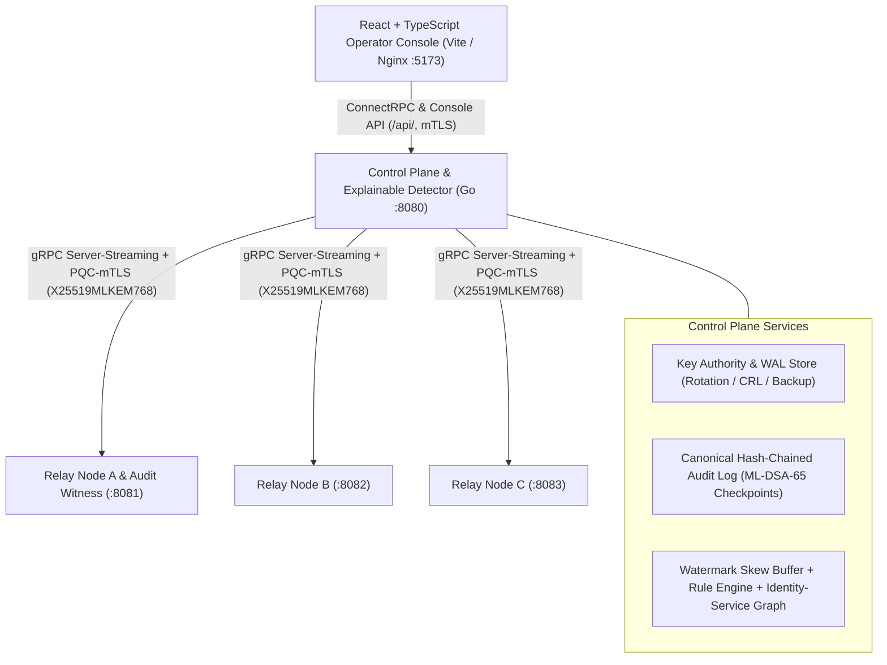

# urGuard

**Post-Quantum Zero-Trust Messaging, Key Lifecycle & Explainable Access Guard**

urGuard combines hybrid post-quantum end-to-end encryption (`X25519 + ML-KEM-768`, `AES-256-GCM`, `ML-DSA-65`) and crash-safe multi-node key governance with a deterministic, zero-AI/ML explainable lateral-movement and activity detection engine.

---

## Architecture



---

## Prerequisites

| Tool | Required Version | Verified Version | Notes |
|---|---|---|---|
| Git | `2.40+` | `2.50.1` | Cloning and LF line-ending handling |
| Docker Engine & Compose | `24.0+` / `v2.24+` | `29.8.2` | Multi-node PQC-mTLS container stack |
| Go | `1.26.0+` | `1.27.1` | `crypto/mlkem`, `tls.X25519MLKEM768`, race tests |
| Node.js & npm | `22.13+` / `10.0+` | `22.21.0` / `10.9.4` | Vite 8, Vitest 5, ConnectRPC TS codegen |
| Python | `3.11+` (`3.12` judging) | `3.11.9` / `3.12` | Runs `track4_service.py` (`pqcrypto==0.4.0` for `protected_read`) |
| GNU Make | `4.0+` | `4.4.1` | Unified workflow targets (via Git Bash on Windows) |

### Windows Notes
- Run `make` and `.sh` scripts inside **Git Bash** (not `cmd.exe` or Windows PowerShell).
- Use `.\scripts\verify_backend.ps1` when running backend checks natively in Windows PowerShell.
- Ensure **Docker Desktop** (Linux container engine) is running before starting Compose.

---

## Quickstart

### Full Multi-Node Stack (Live mTLS Backend + Operator Console)
```bash
cp .env.example .env
# Optional: set URGUARD_BACKUP_PASSPHRASE in .env to enable backup export/restore
docker compose -f deployments/docker-compose.yml up --build -d
```
- Open **http://localhost:5173** for the live Operator Console (`VITE_USE_MOCKS=false`).
- Services booted: `certs-init` -> `controlplane` (`:8080`) + `node-a` witness (`:8081`) + `node-b` (`:8082`) + `node-c` (`:8083`) + `frontend` (`:5173`).
- Tear down cleanly with `docker compose -f deployments/docker-compose.yml down -v`.

### Standalone UI Preview (Mock Mode)
```bash
cd frontend && npm ci && npm run dev
```
- Opens **http://localhost:5173** using the in-memory mock client (`VITE_USE_MOCKS=true` by default).

---

## Track 4 Judging Adapter (`track4_service.py`)

At the repository root:
- **`track4_service.py`** / **`team_app.py`**: Single-request-per-process Python 3.12 entry point (`stdin` JSON -> `stdout` JSON; generic `stderr` only on error).
- **`threat-model.json`**: Root metadata (`{"asset":"protected-resource","boundary":"identity-check"}`).
- **Persistence**: Uses durable SQLite (`PRAGMA synchronous = FULL`) stored in `TRACK4_STATE_DIR` (falling back to the OS temp directory on read-only containers).
- **Supported operations**: `setup`, `read`, `revoke`, `audit`, and `protected_read` (raw Base64 `ML-KEM-768` encapsulation via `pqcrypto==0.4.0` + lowercase hex `HMAC-SHA256(shared_secret, challenge + stored_body)`).

Run local & container verification:
```bash
python scripts/test_toolkit_adapter.py
```

---

## Grace Period, Witness & Clock-Skew Bounds

| Parameter | Env Variable | Default | Behavior & Bounds |
|---|---|---|---|
| Key Rotation Grace Period | `URGUARD_ROTATION_GRACE_SEC` | `30` seconds | `IDLE -> PREPARING -> COMMITTED -> CUTOFF_ENFORCED`; in-flight transfers finish during grace; post-cutoff requests fail with `ERR_KEY_EPOCH_EXPIRED` |
| Detector Clock-Skew Watermark | `URGUARD_MAX_CLOCK_SKEW_SEC` | `30` seconds (`±30s`) | Tested up to `±60s`; events within `< 2 * skew` are flagged `order_uncertain: true`; late arrivals flagged `late_arrival: true` |
| CRL Heartbeat Reconciliation | `URGUARD_CRL_HEARTBEAT_MS` | `1000` ms | Reconciliation backstop alongside immediate gRPC server-streaming CRL pushes |
| Audit Checkpoint Interval | `URGUARD_CHECKPOINT_INTERVAL` | `25` events | Periodic `ML-DSA-65` checkpoints; latest signed head is witnessed durably on `node-a` |

---

## Dependency Inventory (Zero AI/ML Policy)

Automated check: `bash scripts/check-no-ai-deps.sh` (enforced in CI).

### Backend Go Modules (`backend/go.mod`)

| Module | Version | Purpose | License |
|---|---|---|---|
| Go stdlib (`crypto/mlkem`, `crypto/tls`, `crypto/aes`, `crypto/cipher`, `crypto/ecdh`, `crypto/hkdf`) | `go1.26.0` | `ML-KEM-768`, `X25519`, `HKDF-SHA256`, `AES-256-GCM`, hybrid TLS `X25519MLKEM768` | `BSD-3-Clause` |
| `github.com/cloudflare/circl` | `v1.6.1` | Standardized NIST FIPS 204 `ML-DSA-65` digital signatures | `BSD-3-Clause` |
| `connectrpc.com/connect` | `v1.18.1` | ConnectRPC / gRPC / HTTP handlers and streaming | `Apache-2.0` |
| `go.etcd.io/bbolt` | `v1.4.0` | Pure-Go ACID WAL, key epoch, revocation, audit & witness persistence | `MIT` |
| `golang.org/x/crypto` | `v0.44.0` | `Argon2id` backup KDF | `BSD-3-Clause` |
| `golang.org/x/net` | `v0.46.0` | HTTP/2 (`h2c`) support for local testing | `BSD-3-Clause` |
| `google.golang.org/protobuf` | `v1.36.6` | Deterministic Protobuf serialization & runtime | `BSD-3-Clause` |

### Frontend Packages (`frontend/package.json`)

**Runtime:** `@bufbuild/protobuf` (`2.17.0`), `@connectrpc/connect` (`2.3.0`), `@connectrpc/connect-web` (`2.3.0`), `@xyflow/react` (`13.0.2`), `react` (`19.3.1`), `react-dom` (`19.3.1`), `react-router` (`8.5.3`).  
**Development:** `@bufbuild/buf` (`1.75.0`), `@bufbuild/protoc-gen-es` (`2.17.0`), `typescript` (`5.9.3`), `vite` (`8.3.8`), `vitest` (`5.1.2`), `eslint` (`10.15.0`), `prettier` (`3.10.1`), `@testing-library/react` (`16.3.3`), `@testing-library/jest-dom` (`8.0.0`), `jsdom` (`31.0.1`).

---

## Verification & Evaluation Commands

### Backend Full Verification (Build, Vet, Race Tests, Subprocess Crash & Benchmarks)
- **Windows (PowerShell):**
  ```powershell
  .\scripts\verify_backend.ps1
  ```
- **Linux / macOS:**
  ```bash
  sh scripts/verify_backend.sh
  ```
  Covers unit tests (`pkg/pqc`, `pkg/store`, `pkg/auditlog`, `pkg/protocol`, `detector`, `internal/config`, `internal/controlplane`, `internal/node`), 3-relay + witness integration (`TestThreeRelayLifecycle`), subprocess `SIGKILL` crash & rollback tests (`TestSubprocessCrashRecoveryAndRollback`), and `pkg/pqc` benchmarks.

### Detector Evaluation & PQC CLI Benchmarks
```bash
cd backend
go run ./cmd/detector-eval -json
go run ./cmd/urguard-cli bench
```

### Frontend Checks & Build
```bash
cd frontend
npm run typecheck && npm run lint && npm test && npm run build
```

---

## Track 4 Checklist Mapping

| # | Objective | Verified Behavior |
|---|---|---|
| 1 | **Key Rotation & Grace Period** | Two-phase WAL rotation (`PREPARING -> COMMITTED -> CUTOFF_ENFORCED`), in-flight transfers survive `30s` grace, post-cutoff requests fail with `ERR_KEY_EPOCH_EXPIRED` across all 3 nodes |
| 2 | **Revocation Across Nodes** | gRPC server-streaming CRL push + `AckControlUpdate` enforcement across 3 nodes (`revocation_propagation_ms` reported); device re-enrollment rewraps DEKs while collaborators retain access |
| 3 | **Crash Recovery** | Subprocess kill during `PREPARING` rolls back uncommitted epoch on restart; committed keys stay active and revoked devices stay revoked |
| 4 | **Backup Integrity** | `ExportBackup` / `RestoreBackup` protects snapshots with Argon2id + `AES-256-GCM` + SHA-256 manifest + `ML-DSA-65` signature; tampering fails with `ERR_BACKUP_CORRUPTED` and logs `BACKUP_INTEGRITY_FAILURE` |
| 5 | **Log Integrity** | Canonical JSON isolates `user_text` against injection; SHA-256 hash chain + `ML-DSA-65` checkpoints + live `node-a` witness detect edits, missing/reordered records, and DB rollbacks |
| 6 | **Routine vs. Suspicious** | Explainable rule + EWMA statistical classifier (`backend/detector`) achieves `F1=1.0000`, `200.00 ms` median alert latency, `0.00` false alerts / 1k benign events on `detector/testdata/events.csv` |
| 7 | **Lateral Movement** | Directed identity-to-service access graph flags multi-hop pivots and disjoint concurrent sessions with `identity`, `services[]`, `event_ids[]`, and `path_or_rule` |
| 8 | **Clock Differences** | Watermark buffer supports `±30s` (tested to `±60s`), flags `late_arrival` and `order_uncertain` pairs with `possible_orderings` |
| 9 | **Replay & Recipient Binding** | AEAD AAD + `ML-DSA-65` signatures enforce `ERR_RECIPIENT_MISMATCH`; 64-message sliding replay window enforces `ERR_REPLAY_DETECTED` |
| 10 | **Forward Secrecy** | Ephemeral `X25519 + ML-KEM-768` per-session keys are zeroized on close; exposing long-term `ML-DSA-65` identity seeds cannot decrypt past captures |
| 11 | **Delivery Under Loss / Reorder** | Out-of-order chunks (`[2, 0, 3, 1]`) reassemble intact; missing/corrupted chunks discard buffered plaintext (`DELIVERY_FAILED`) |
| 12 | **Session Resumption** | Encrypted server `ResumptionTicket` + single-use challenge-response bound to peer `ML-DSA-65` identity (`ERR_SESSION_IDENTITY_MISMATCH` on mismatch) |

---

## Known Limits
- **Nginx Reverse Proxy TLS Group:** `nginx:1.27.4-alpine` OpenSSL connects to `controlplane` over TLS 1.3 mTLS using `X25519` fallback, while all Go-to-Go internal control and relay links negotiate hybrid `X25519MLKEM768`.
- **Witness & Pin Trust Assumptions:** Rollback detection requires storing the `node-a` witness database outside the control plane's restore path and distributing `authority.pub` via a trusted channel.
- **Synthetic Evaluation Scope:** Detector accuracy metrics (`F1=1.0000`, `0` false positives) are measured on the Track 4 practice dataset and synthetic 1k-event benchmark, not production telemetry.

---

## Documentation Deliverables
- **1-Page Threat Model:** [docs/threat-model.md](docs/threat-model.md)
- **2-Page Printable Project Brief (A4):** [docs/project-brief.html](docs/project-brief.html) *(print/export to PDF with Background Graphics enabled; embed your 5-minute demo video link)*
- **5-Minute Demo Walkthrough:** [docs/demo-script.md](docs/demo-script.md)
